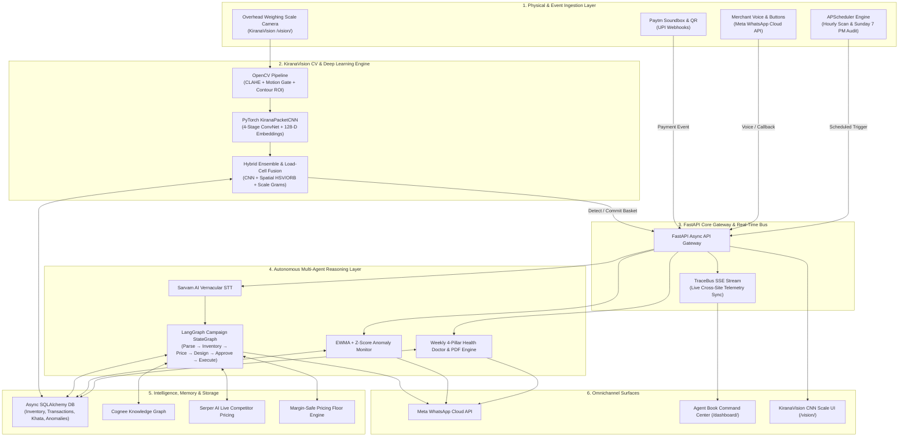
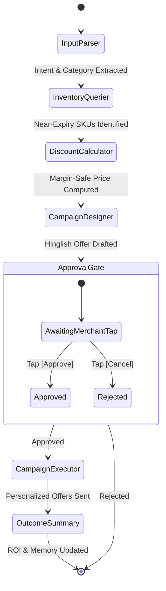
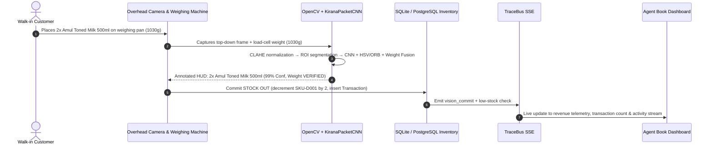
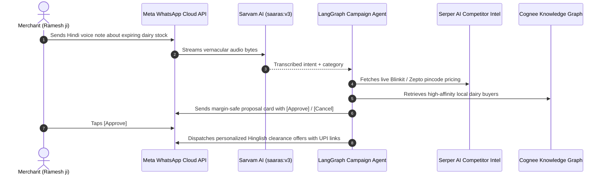

# KiranaMate — MerchantMind AI & KiranaVision
### *The Autonomous Business Teammate and Computer-Vision Countertop Inventory Engine for 12+ Million Indian Kirana Stores*

[](https://python.org)
[](https://fastapi.tiangolo.com)
[](https://langchain-ai.github.io/langgraph/)
[](https://pytorch.org)
[](https://opencv.org)
[](https://developers.facebook.com/docs/whatsapp/)
[](https://sarvam.ai)
[](https://cognee.ai)

---

> **"Like a GPS and an optical inventory clerk for your store — always watching the counter, always guiding the business, never needing to be asked."**  
> *Zero-app adoption friction, overhead CNN countertop recognition fused with weighing-scale load cells, vernacular voice-first interaction, proactive multi-agent intelligence, and 100% margin-guaranteed execution.*

---

## 1. Executive Summary

India's retail landscape is anchored by **over 12 million neighborhood grocery stores (*Kiranas*)**, accounting for over **85% of the country's $800B+ retail food and grocery market**. These merchants face structural pressure from algorithm-driven Quick-Commerce platforms (Blinkit, Zepto, Swiggy Instamart) that rely on dynamic pricing, predictive replenishment, and real-time inventory telemetry.

While large retailers run enterprise ERP systems and automated warehouses, a typical Kirana owner works 14–16 hours daily with a paper ledger (*Bahi-Khata*), a counter-top Paytm Soundbox, a digital weighing machine, and a smartphone used primarily for **WhatsApp**.

**KiranaMate** unifies two tightly integrated surfaces to modernize Kirana operations without manual barcode scanning or software friction:

1. **Agent Book (MerchantMind AI Command Center — `/dashboard/`):** An autonomous multi-agent business teammate operating over **Meta WhatsApp Cloud API** and **Sarvam AI Vernacular Voice**. It monitors real-time transaction velocity, detects category sales anomalies against 4-week baselines, benchmarks live Quick-Commerce competitor pricing via Serper AI, designs margin-safe Hinglish clearance campaigns with Human-in-the-Loop approval gates, recovers overdue *Khata* credit politely, and generates Sunday vector PDF store health audits.
2. **KiranaVision (Overhead CNN & Weighing Scale Inventory Engine — `/vision/`):** A computer-vision product recognition system mounted above the store's counter and digital weighing machine. Combining a **4-stage PyTorch Convolutional Neural Network (`KiranaPacketCNN`)**, **OpenCV spatial preprocessing and HSV/ORB feature matching**, **live few-shot packet enrollment**, and **weighing-scale load-cell fusion**, it automatically identifies packets placed on the counter (such as Amul Toned Milk, Amul Butter, Maggi Noodles, Lay's, Tata Salt, and Coca-Cola), reconciles stacked quantities by gram weight, updates database inventory (`STOCK OUT` sales and `STOCK IN` deliveries), and streams real-time telemetry directly into the Agent Book.

---

## 2. The Problem Landscape

```
┌───────────────────────────────────────────────────────────────────────────────────┐
│                           THE KIRANA CRISIS IN NUMBERS                            │
├─────────────────────┬───────────────────────────┬─────────────────────────────────┤
│    12+ Million      │          $800B+           │            40% - 60%            │
│   Kirana Stores     │   Retail Market Value     │   Drop in Walk-ins (Q-Commerce) │
├─────────────────────┼───────────────────────────┼─────────────────────────────────┤
│     14-16 Hours     │         ₹45,000+          │            15% - 25%            │
│   Daily Work Hours  │   Trapped Working Capital │   Perishables Expiring Unsold   │
└─────────────────────┴───────────────────────────┴─────────────────────────────────┘
```

### 2.1 The SaaS & Barcode Adoption Paradox
Traditional billing software and mobile ERP apps experience over 80% churn among Indian Kiranas because merchants handling 200–400 daily walk-ins cannot stop to scan individual barcodes, navigate English menus, or manually key in stock arrivals.

### 2.2 The Triple Silent Margin Bleed
1. **Perishable Dead Stock & Inventory Blindness:** Dairy and packaged staples (milk pouches, paneer, curd, bread, snacks) expire silently when stock levels are not tracked as packets cross the billing counter.
2. **Asymmetric Pincode Pricing Blindness:** Merchants have no live visibility into Blinkit or Zepto pricing 400 meters away, resulting in uncompetitive pricing or eroded margins.
3. **Informal Khata (Credit) Float Paralysis:** Unpaid neighborhood credit starves working capital while merchants hesitate to send harsh payment reminders that risk long-standing community trust.

---

## 3. Core Architectural Philosophy

```
Traditional Retail Tools (High Friction)     KiranaMate + KiranaVision (Ambient AI)
┌──────────────────────────────────────┐     ┌──────────────────────────────────────────┐
│ Manual Barcode Scanning & Keying     │     │ Overhead Counter Camera + Weight Scale   │
│ Standalone Desktop / Mobile ERP Apps │ VS  │ 100% WhatsApp Native + Live Web Surfaces │
│ Passive Historical Ledgers           │     │ Proactive LangGraph Multi-Agent Triggers │
│ English Text-Heavy Dashboards        │     │ Sarvam AI Vernacular Hinglish Voice      │
└──────────────────────────────────────┘     └──────────────────────────────────────────┘
```

- **Overhead Countertop Optics over Under-Table Cameras:** Mounting a downward-facing camera above the weighing machine keeps optics clean from flour dust (*atta*) and countertop scratches, captures clear top/front packet branding, segments multiple items side-by-side, and fuses naturally with the weighing scale's gram readout.
- **WhatsApp-Native Human-in-the-Loop Execution:** LangGraph checkpoints every proposed campaign before dispatch, allowing the merchant to review margin-safe clearance pricing and approve with a single WhatsApp tap.
- **Knowledge Graph Semantic Memory (Cognee):** Models relational customer affinities (`Customer` → `Product Category` → `Price Sensitivity` → `Khata Repayment Behavior`) rather than flat tables.
- **Live Competitor Benchmarking (Serper AI):** Queries hyper-local Blinkit, Zepto, and Instamart prices at runtime before computing clearance discounts.

---

## 4. Repository Organization

```
KiranaMate/
├── agents/                         # LangGraph & Autonomous Background Agents
│   ├── sales_monitor.py            # Hourly EWMA/Z-Score Sales Deviation & Khata Trigger
│   ├── campaign_executor.py        # Stateful Multi-Node Clearance Campaign Engine
│   └── weekly_report.py            # 4-Pillar Health Scoring & ReportLab PDF Generator
│
├── api/                            # FastAPI Asynchronous Gateway & Routers
│   ├── index.py                    # Serverless ASGI Entrypoint
│   ├── main.py                     # App Lifespan, Scheduler, Routers & Static Mounts
│   ├── routes_merchant.py          # Store Telemetry, Transactions, Khata & Inventory APIs
│   ├── routes_campaign.py          # Voice/Text Campaign Initiation & Approval APIs
│   ├── routes_vision.py            # CNN Detection, Few-Shot Enrollment & Basket Commit APIs
│   ├── routes_webhook.py           # Meta WhatsApp Cloud API & Paytm Webhooks
│   ├── routes_health.py            # Diagnostic Report & System Health Endpoints
│   └── routes_trace.py             # Real-Time Server-Sent Events (SSE) Trace Stream
│
├── core/                           # External Service Integrations & Event Bus
│   ├── whatsapp_client.py          # Meta WhatsApp Cloud API Wrapper
│   ├── sarvam_client.py            # Sarvam AI Vernacular Speech-to-Text Client
│   ├── serper_client.py            # Live Competitor Pricing Intelligence Client
│   ├── cognee_client.py            # Semantic Knowledge Graph Memory Client
│   ├── trace_bus.py                # Real-Time SSE Event Bus Syncing Both Sites
│   └── tunnel_manager.py           # Development Webhook Tunnel Lifecycle Manager
│
├── vision/                         # KiranaVision — CNN + OpenCV Recognition Package
│   ├── product_catalog.py          # 12-SKU Physical/Visual Profiles & Reference Renderer
│   ├── opencv_pipeline.py          # CLAHE Normalization, Motion Gate, ROI & HUD Overlay
│   ├── cnn_recognizer.py           # 4-Stage PyTorch KiranaPacketCNN & Weight Fusion Engine
│   ├── train_cnn.py                # Synthetic Augmentation & CNN Weight Trainer
│   ├── weights/
│   │   └── kirana_cnn.pt           # Pre-Trained PyTorch CNN Model Weights
│   └── ui/                         # KiranaVision Dedicated Frontend Site (/vision/)
│       ├── index.html              # Countertop Camera, Weighing Scale & Layer Inspector UI
│       ├── style.css               # Unified Design Tokens & Dark-Mode Camera HUD Styles
│       └── app.js                  # WebRTC Camera, Virtual Scale Bench & Inventory Sync
│
├── dashboard/                      # Agent Book — Merchant Command Center (/dashboard/)
│   ├── index.html                  # Real-Time Store Telemetry & Agent Swarm Dashboard
│   ├── style.css                   # Clean White Canvas & Typography Design System
│   └── app.js                      # Live SSE Stream Listener & Interactive Controls
│
├── db/                             # Persistence Layer
│   ├── database.py                 # Async SQLAlchemy Engine & Session Lifecycle
│   ├── models.py                   # Merchant, Transaction, Inventory, Khata & Anomaly Models
│   └── seed.py                     # Realistic 12-SKU Kirana Store Demo Dataset Seeder
│
├── utils/                          # Deterministic Mathematical Engines
│   ├── anomaly_detector.py         # 4-Week Rolling Baseline & Z-Score Engine
│   └── discount_calculator.py      # Cost-Floor & Margin-Guaranteed Pricing Calculus
│
├── .env.example                    # Environment Key Reference Template
├── .python-version                 # Target Python Runtime Version
├── requirements.txt                # Application & Deep-Learning Dependencies
└── vercel.json                     # Static & API Edge Rewrite Configuration
```

---

## 5. High-Level System Architecture



---

## 6. KiranaVision — Countertop CNN & Weighing Scale Engine

### 6.1 Tracked Kirana SKU Catalog (12 Classes, 8 Hero Countertop Items)

All 12 seeded store products in `db/seed.py` are mapped end-to-end across the PyTorch classifier, OpenCV feature bank, weighing scale physical tolerances, and SQLite/PostgreSQL inventory rows:

| Class | SKU ID | Product Name | Category | Unit Weight | Selling Price | Tier |
| :---: | :--- | :--- | :--- | :---: | :---: | :---: |
| `0` | `SKU-D001` | **Amul Toned Milk 500ml** | `dairy` | 515 g | ₹30 | Hero |
| `1` | `SKU-D002` | **Amul Paneer 200g** | `dairy` | 205 g | ₹68 | Hero |
| `2` | `SKU-D003` | **Mother Dairy Curd 400g** | `dairy` | 412 g | ₹42 | Hero |
| `3` | `SKU-D004` | **Amul Butter 100g** | `dairy` | 104 g | ₹56 | Hero |
| `4` | `SKU-SN001` | **Maggi 2-Min Noodles 70g** | `snacks` | 73 g | ₹15 | Hero |
| `5` | `SKU-SN002` | **Lay's Classic Salted 26g** | `snacks` | 28 g | ₹10 | Hero |
| `6` | `SKU-S002` | **Tata Salt 1kg** | `staples` | 1010 g | ₹24 | Hero |
| `7` | `SKU-B001` | **Coca Cola 600ml** | `beverages` | 635 g | ₹40 | Hero |
| `8` | `SKU-S003` | Fortune Sunflower Oil 1L | `staples` | 925 g | ₹155 | Store |
| `9` | `SKU-S001` | Aashirvaad Atta 5kg | `staples` | 5040 g | ₹280 | Store |
| `10` | `SKU-PC001` | Surf Excel 1kg | `personal_care` | 1015 g | ₹220 | Store |
| `11` | `SKU-PC002` | Dove Soap 100g | `personal_care` | 108 g | ₹52 | Store |

### 6.2 Three-Stage Computer Vision Pipeline

1. **Stage 1 — OpenCV Spatial Preprocessing (`vision/opencv_pipeline.py`):**
   - Applies **LAB-space CLAHE** to stabilize exposure under harsh Kirana fluorescent lighting and overhead shadows.
   - Evaluates frame-to-frame motion via grayscale absolute differencing to confirm hands have cleared the weighing pan.
   - Combines Canny edge detection with HSV saturation and brightness thresholding inside the calibrated weighing-pan ROI to isolate multiple distinct packets simultaneously.
2. **Stage 2 — Hybrid PyTorch CNN & Feature Ensemble (`vision/cnn_recognizer.py`):**
   - **`KiranaPacketCNN`:** A 4-stage convolutional architecture (`3 → 24 → 48 → 96 → 128` channels with BatchNorm, ReLU, adaptive spatial pooling, and an L2-normalized 128-D prototype embedding head) running in ~50ms on standard CPU hardware.
   - **OpenCV Spatial HSV & ORB Fusion:** Computes 3-zone vertical spatial HSV histograms (top/middle/bottom packaging bands) plus ORB keypoint matching to distinguish similar color palettes reliably.
   - **Live Few-Shot Enrollment:** Merchants can hold any physical packet under the overhead camera and enroll its 128-D CNN embedding, HSV profile, and ORB descriptors on the spot without offline retraining.
3. **Stage 3 — Weighing Machine Load-Cell Sensor Fusion:**
   - Cross-validates visual classification against the digital scale reading in grams, automatically resolving stacked identical items (for example, inferring `2 × Amul Toned Milk 500ml` when a single milk pouch stack weighs ~1030g) and flagging weight mismatches.

### 6.3 Dual Inventory Modes & Cross-Site Sync
- **Counter Sale (`STOCK OUT`):** Deducts recognized packet counts from `InventoryItem.quantity`, records a `Transaction`, checks low-stock reorder thresholds, and emits real-time events to the Agent Book SSE feed.
- **Supplier Delivery (`STOCK IN`):** Scans incoming distributor packs on the counter and increments store stock levels immediately.

---

## 7. Autonomous Multi-Agent Workflows

| Agent | Trigger Cadence | Core Responsibility |
| :--- | :--- | :--- |
| **Sales Anomaly Monitor** | Hourly Background Loop | Tracks category revenue vs. 4-week rolling baselines and escalates critical drops + overdue Khata accounts |
| **LangGraph Campaign Executor** | Voice / Text / Alert Action | Orchestrates goal parsing, near-expiry SKU filtering, competitor scraping, margin-safe pricing, approval gating, and WhatsApp dispatch |
| **Weekly Business Health Doctor** | Sunday 7:00 PM IST / On-Demand | Computes the 0–100 4-pillar store vitality score, compiles a multi-page ReportLab PDF, and delivers via WhatsApp |
| **KiranaVision Scale Agent** | Continuous Countertop Vision | Recognizes packets on the weighing machine, updates live stock, logs sales, and raises low-stock WhatsApp alerts |



---

## 8. Mathematical Foundations

### 8.1 Statistical Sales Anomaly Detection (EWMA + Z-Score)
For category $c$ on day-of-week $d$ over a 4-week rolling historical window ($W = 4$, decay $\alpha = 0.4$):

$$\mu_{c,d} = \frac{\sum_{w=1}^{W} \alpha (1 - \alpha)^{w-1} \cdot R_{c,d,w}}{\sum_{w=1}^{W} \alpha (1 - \alpha)^{w-1}}$$

$$\Delta_{pct} = \left( \frac{R_{actual} - \mu_{c,d}}{\mu_{c,d}} \right) \times 100, \qquad Z_c = \frac{R_{actual} - \mu_{c,d}}{\sigma_{c,d}}$$

A **CRITICAL Anomaly** triggers when $\Delta_{pct} \le -30.0\%$ and $Z_c \le -1.96$.

### 8.2 Margin-Safe Dynamic Pricing Floor
All clearance prices are mathematically bounded above wholesale cost ($C_{unit}$) with a strict minimum gross margin ($\mu_{min} = 0.05$) while undercutting the lowest live Quick-Commerce competitor by $\delta_{undercut} = 0.05$:

$$P_{floor} = C_{unit} \times (1 + \mu_{min}), \qquad P_{comp\_target} = \min(P_{Blinkit}, P_{Zepto}) \times (1 - \delta_{undercut})$$

$$P_{final} = \max\left( \min(P_{comp\_target}, P_{historical\_best}), \; P_{floor} \right)$$

### 8.3 Hybrid CNN + Weighing Scale Load-Cell Fusion
For each candidate SKU $k$ with nominal unit mass $W_k$ and tolerance $\tau_k$, stacked multiplicity $m \in \{1, 2, 3, 4\}$ is scored via a Gaussian load-cell likelihood fused with CNN softmax probability $P_{CNN}$, 128-D prototype cosine similarity $S_{emb}$, spatial HSV score $S_{HSV}$, and ORB keypoint score $S_{ORB}$:

$$P_{weight}(k, m) = \exp\left( -\frac{(W_{scale} - m \cdot W_k)^2}{2 \cdot (\max(\tau_k \sqrt{m} \cdot 1.4, 18))^2} \right)$$

$$S_{total}(k) = 0.34\,P_{CNN}(k) + 0.22\,S_{emb}(k) + 0.24\,S_{HSV}(k) + 0.06\,S_{ORB}(k) + 0.14\,\max_m P_{weight}(k, m)$$

### 8.4 4-Pillar Composite Business Health Score (0–100 Scale)

$$S_{total} = S_{rev} + S_{inv} + S_{ret} + S_{khata}$$

| Pillar | Evaluated Dimension | Max Points |
| :--- | :--- | :---: |
| **Revenue Health ($S_{rev}$)** | Week-over-week revenue momentum | 25 |
| **Inventory Vitality ($S_{inv}$)** | Share of active stock outside 7-day expiry risk | 25 |
| **Customer Retention ($S_{ret}$)** | Repeat buyer frequency over rolling 14-day window | 25 |
| **Khata Float Health ($S_{khata}$)** | Ratio of healthy vs. >30-day overdue informal credit | 25 |

---

## 9. End-to-End Operational Sequences

### 9.1 Countertop Weighing Scale to Inventory & Agent Book Sync



### 9.2 Voice-to-Clearance Campaign Execution



---

## 10. Technology Stack Overview

| Layer | Technology | Role in KiranaMate |
| :--- | :--- | :--- |
| **API Gateway** | FastAPI + Uvicorn (Async) | Low-latency REST, webhook, and SSE streaming gateway |
| **Computer Vision** | OpenCV | CLAHE lighting correction, motion gating, ROI contour segmentation, HUD rendering |
| **Deep Learning** | PyTorch (`KiranaPacketCNN`) | 4-stage ConvNet classifier & 128-D visual prototype embedding extractor |
| **Agent Orchestration** | LangGraph StateGraph | Stateful multi-node workflows with Human-in-the-Loop breakpoints |
| **LLM Reasoning** | Google Gemini / OpenAI Fallback | Intent extraction, vernacular offer copy, and strategic recommendations |
| **Vernacular Speech** | Sarvam AI (`saaras:v3`) | Noise-resilient Indian dialect and Hinglish voice transcription |
| **Semantic Memory** | Cognee Knowledge Graph | Associative customer affinity, elasticity, and repayment graph |
| **Market Intelligence** | Serper AI | Live hyper-local Quick-Commerce competitor price benchmarking |
| **Messaging Channel** | Meta WhatsApp Cloud API | Zero-friction alerts, interactive approvals, and PDF delivery |
| **Diagnostics & PDFs** | ReportLab | Automated multi-page vector store health audit reports |
| **Persistence** | SQLAlchemy Async (SQLite / PostgreSQL) | Unified transactional store for Inventory, Sales, Khata, and Campaigns |

---

## 11. API Surface Summary

| Route Group | Key Endpoints | Purpose |
| :--- | :--- | :--- |
| **KiranaVision (`/api/vision`)** | `GET /catalog`, `POST /detect`, `POST /enroll`, `POST /train`, `POST /commit-basket` | Overhead CNN + OpenCV detection, few-shot enrollment, training, and live inventory updates |
| **Merchant Telemetry (`/merchant`)** | `GET /dashboard`, `GET /transactions`, `GET /inventory`, `GET /anomalies`, `GET /khata`, `POST /khata/remind` | Real-time store metrics, expiry status, anomaly resolution, and polite Khata recovery |
| **Campaign Swarm (`/campaign`)** | `POST /text`, `POST /voice`, `POST /{id}/approve` | Trigger and resume Human-in-the-Loop LangGraph clearance campaigns |
| **Webhooks (`/webhook`)** | `GET /whatsapp`, `POST /whatsapp`, `POST /paytm` | Meta Cloud API verification, voice/button ingestion, and Paytm Soundbox receipts |
| **Health & Trace (`/report`, `/api/trace`)** | `GET /report/pdf`, `GET /api/trace/stream`, `GET /api/trace/events` | Weekly PDF report downloads and real-time SSE synchronization across surfaces |

---

## 12. Technical Design Q&A

**Why mount the KiranaVision camera overhead above the weighing machine instead of under the table?**  
Under-table glass counters scratch quickly and accumulate flour dust (*atta*) and spills that degrade optics, while product branding is primarily printed on the top and front faces. An overhead downward-facing camera captures crisp branding, separates multiple items side-by-side, and pairs directly with the weighing machine's gram sensor to count stacked packets reliably.

**How does the system handle real physical packets in varied store lighting without massive labeled datasets?**  
KiranaVision combines LAB-space CLAHE lighting normalization with a hybrid ensemble (4-stage PyTorch CNN + spatial HSV band histograms + ORB descriptors + scale weight Gaussian likelihood) and includes one-click **few-shot live enrollment** directly from the webcam feed.

**How are LLM pricing hallucinations prevented during automated clearance campaigns?**  
All pricing math is isolated inside a deterministic Python pricing engine (`utils/discount_calculator.py`) that strictly clamps every final clearance price above wholesale cost plus a 5% minimum profit margin ($P_{final} \ge C_{unit} \times 1.05$).

---

## 13. License

Released under the **MIT License** — built to empower India's neighborhood Kirana merchants.
